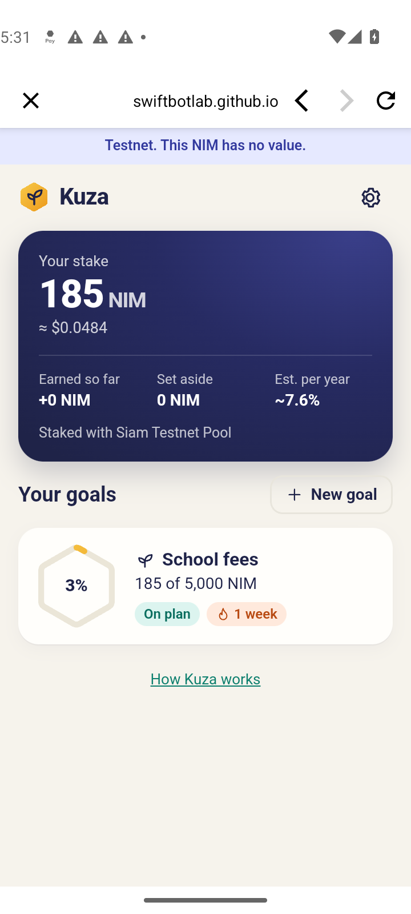
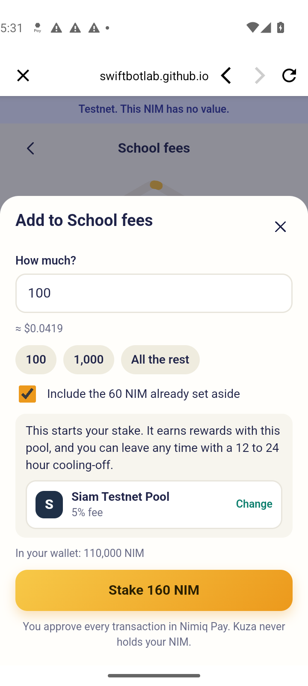
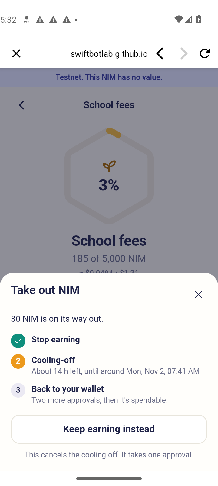

# Kuza

Savings goals in your own NIM stake, as a Mini App for [Nimiq Pay](https://nimiq.com). *Kuza* means "grow" in Swahili.

You set a goal. Your NIM goes into your own stake with a validator, so it earns while it waits. Kuza never holds it:
every move is a transaction you approve in Nimiq Pay.

**Live:** https://kuza.swiftbotlab.workers.dev/ (open it in Nimiq Pay under Mini Apps. A normal browser shows a landing
page with a demo that uses pretend NIM.)

<p>
  
  
  
</p>

*Screenshots from the real Nimiq Pay app on mainnet, on a real Android phone, with real NIM.*

## What it does

- **Goals:** a name, a target, an optional date and a saving plan per week or per month.
- **Plan:** the next saving and when it's due, on plan or behind (against your date, or against the plan), when the goal
  lands at this pace, a streak, and a moment at 25, 50 and 75%.
- **Saving:** a staking transaction that you approve. Under the network's 100 NIM minimum for a new stake, the goal
  fills in your wallet instead and tells you how far you are from being able to stake.
- **Starting:** NIM already in your wallet shows under your stake, and the first saving fills in what you can
  spare (a little is kept for fees). You can change it before you approve.
- **Progress:** your stake and what it earned are read from the chain. Streaks, set-aside notes and how stake is split
  between goals are kept on your phone.
- **Rewards:** Earned is only what the chain proves: your stake minus every deposit into it from your wallet's accounts
  (the wallet address and each payment account it funded), plus what you took out. If that history can't be read
  completely, Kuza shows "not known yet" instead of a number. Each payout is listed with the day this phone first saw it,
  next to your pool, its real fee and how it pays out.
- **Reaching a goal:** a celebration, then three ways on: start the next goal (its stake can count toward the new one,
  with no transaction, because the NIM stays where it is), use the money, or raise the target and keep it growing.
- **Using the money:** the real unstaking path and wait, then pay any Bitcoin Lightning invoice from your wallet. Kuza
  hands the invoice to Nimiq Pay, which shows the price, lets you pay with NIM or USDT and asks you to approve. Kuza
  itself sells nothing and swaps nothing.
- **Breaking a goal:** shows the real unstaking path and the real wait, with live block numbers.
- **Friends chip in:** a short invite link, a ready message to copy and a QR code. Opened in a phone browser, the link
  shows the goal, one button into Nimiq Pay (on Android it falls back to the Play Store when the app isn't there) and
  what Nimiq Pay is. A gift goes from the friend's wallet straight to your address with a note, which Kuza reads
  on-chain and counts toward the goal. After it lands, the friend sees the goal move and can start a goal of their own.
  Older `?jar=` links still open.
- **English, Spanish, French and Swahili**, following the language set in Nimiq Pay.

## What it doesn't do

Staked NIM isn't held back by any rule that stops its owner. You can start taking it out at any time, and the
network's cooling-off takes about 12 to 24 hours. Kuza's goals work through that pause and your own plan, not through
force. The Nimiq provider can't create vesting contracts, so an enforced time lock isn't possible from a Mini App.

Reward figures are estimates and they change. They're labelled that way in the app.

## Tested so far

On mainnet, in the real Nimiq Pay app on two real Android phones, with real NIM. Each transaction was read back from
the chain:

| Step | Transaction | Block |
|---|---|---|
| New stake, 1,000 NIM | [`4154661745fa442c…`](https://nimiq.watch/#4154661745fa442c9c4dc3963ca1002de00405d063934b60e3e34e468e5ffc8e) | 65,870,430 |
| Top-up, 60 NIM | [`200eaaef6344b261…`](https://nimiq.watch/#200eaaef6344b26195f175436e45dfd9f2cc644f27360c0fb44810a99e528e4b) | 65,870,509 |
| Stop earning on 60 NIM | [`0b29e3e1a92eb5b8…`](https://nimiq.watch/#0b29e3e1a92eb5b8039f81004a6da78cfa0304fe978159d9cc386c2644c9edda) | 65,870,706 |
| A friend's gift, 100 NIM with a note, from a second phone | [`6a449594631de6e0…`](https://nimiq.watch/#6a449594631de6e0ca7ba6e88409ae82b36c0db66ffa1a93726c3179f6336b50) | 65,872,372 |
| The gift moved into the stake, 100 NIM | [`f196139159689150…`](https://nimiq.watch/#f196139159689150dd50ef37cee031f53bc66e7c16220e7db5fc5351139a9140) | 65,872,612 |
| Retire the released 60 NIM, after the cooling-off | [`0386938fbc602dea…`](https://nimiq.watch/#0386938fbc602dea0fcfe92332731a8b0d197c5588ba66f30c90fe5a896d3768) | 65,924,317 |
| Remove: 60 NIM from the staking contract back to the wallet | [`fbd6cde2ef983414…`](https://nimiq.watch/#fbd6cde2ef9834146a0ec0e608cdab924982819549c9658f8e115e0babe58eb2) | 65,924,337 |
| A gift through the new invite link, 10 NIM, from the second phone | [`99dfdcce6410453b…`](https://nimiq.watch/#99dfdcce6410453bdc92552d0fdc413fcdcc362e76f95103c5f585b320b580f4) | 66,205,771 |
| A Lightning payment from a goal, 30 sats paid with 82.05884 NIM, from the second phone | [`87d870217979881c…`](https://nimiq.watch/#87d870217979881c949d33bdf534ccced31cd0f7efd46b6e19702c110306243a) | 66,242,444 |
| The swap's HTLC redeemed with the Lightning preimage, 6 seconds later | [`4e34eed227929e7d…`](https://nimiq.watch/#4e34eed227929e7d6e14ec2027690de28888fb13c53ae44d2763cbeef7753586) | 66,242,450 |

That is the whole cycle, including the way out: Kuza had worked out the release at block 65,923,200, the retire went
through at 65,924,317, and after the two approvals the staker shows 1,100 NIM active, 0 inactive and 0 retired. Also
on mainnet: connecting, the safety warning on an invite link, the live cooling-off, the gift counted toward the goal,
and goals surviving a close and reopen. Before that, every flow ran on testnet, on an emulator and a real phone.

On 6 November, with v3, on mainnet:

- **Invite link into Nimiq Pay:** on the second phone the invite link, opened in Android Chrome, showed the invite page;
  "Chip in with Nimiq Pay" opened Nimiq Pay (PIN), then Nimiq Pay's own "Open this mini app?" warning, then Kuza's
  friend view of the first phone's goal, with the warning and the full address above the amount.
- **A gift and what comes after it:** 10 NIM sent through Nimiq Pay's own Connect and Confirm sheets to
  `NQ32 9CGX GGYH 2DNL D7AL AQGM FHU8 SJ5U 8DKM` with the goal's note (the last row above). The thank-you screen showed
  +10 NIM, 110 of 50,000 NIM and 2 wallets chipped in, with the link to the transaction; its "New phone" idea opened a
  new goal form with the name filled in.
- **Reopening on the first phone:** no Connect sheet, Earned +0 NIM (correct: no reward has reached the stake yet), the
  rewards sheet matching it, and "Copy invite message" as the main share button inside Nimiq Pay.
- **Security headers:** Kuza still loads inside Nimiq Pay with the headers that forbid framing.

On 7 November, on mainnet, on the second phone:

- **A Lightning payment through Kuza:** a goal with 70 NIM set aside reached 100%; "Use the money", then "Pay a
  Lightning invoice" with a 30-sat invoice. Kuza handed it to Nimiq Pay, which asked "Pay Bitcoin Lightning" with NIM
  or USDT on Polygon; with NIM its confirm sheet read "Merchant receives 0.0000003 BTC, You spend 82.05884 NIM, Network
  fee (included) 0.00000001 BTC, Service fee (included) 0.20464 NIM". After the approval Kuza said "Payment
  submitted" and listed "Paid a Lightning invoice · 30 sats". On chain: 82.05884 NIM left the second phone's wallet
  into an HTLC (`NQ89 V0MN CVGT 3RC9 B7PA F1YJ L564 TEMK A0TM`) at 05:28:00 UTC, and 6 seconds later the HTLC was
  redeemed with the preimage `b2009745667f73947cac22d83aaea32b161266cfbfc27b4fc6b6944def43b3cf` (in the redeem
  transaction's proof). A Lightning preimage is only released once the invoice is paid, so the payment went through end
  to end. Anyone can check it: sha256 of the preimage is `ec640c4dc20e72d76582035cf780c7d6d645dce995617efbb9d91b38c5bbf5a6`,
  which is both the HTLC's hash root (in the first transaction) and the 30-sat invoice's payment hash.
- **Found and fixed the same day:** a garbled paste now fails Kuza's own check (the invoice checksum) instead of
  reaching Nimiq Pay; "Use the money" no longer calls savings set aside in the wallet "in your own stake"; and a
  payment now comes off what the goal holds, so the goal no longer shows the 70 NIM as still set aside.

Not tested yet on a real phone: an iPhone; the invite page's button on a phone without Nimiq Pay installed (the Play
Store fallback); monthly plans and moving a goal on (these run in the demo and the tests). Rewards: the pool's first
payout reached the stake on 7 November. Kuza's Earned, proven from the chain (stake minus deposits plus withdrawals), is
1.00054 NIM, and the live site shows +1 NIM for the wallet; it has not been photographed on the phone yet. All wallets
above are our own test wallets; we know of no outside user yet.

## Who has used it

Kuza counts each wallet once, when it connects on mainnet. Only a keyed hash is stored, so the count can't say whose
wallets they are. The live number: https://kuza-api.swiftbotlab.workers.dev/v1/stats

On 6 November 2026 it read **6 wallets**:

- **2 are ours:** the test wallet `NQ32 9CGX GGYH 2DNL D7AL AQGM FHU8 SJ5U 8DKM` on the first phone, which made every
  goal transaction above, and `NQ04 HH5C HSLU VHGD EP4G BA1R 1MGB PT0X EY9V` on the second phone, counted when it sent
  the gift.
- **The other 4:** we can't tell whose they are. Some may be our own earlier test sessions, so we don't count any of
  them as outside users.

Outside wallets with a transaction made through Kuza:

| Wallet | What it did | Transaction |
|---|---|---|
| none known yet | | |

If you've saved with Kuza and are happy to be listed here, open an issue with the transaction link.

## How the unstaking wait is worked out

| Step | Transaction | Rule |
|---|---|---|
| Stop earning | `sendSetActiveStakeTransaction` | Inactive from the next election block (one every 43,200 blocks) |
| Cooling-off | none | Released one epoch after that, so 12 to 24 hours at about one block a second |
| Retire | `sendRetireStakeTransaction` | Only released stake. What stays must be 0 or at least 100 NIM |
| Remove | `sendRemoveStakeTransaction` | Must take the whole retired balance |

If the pool's validator is jailed, the stake can't leave until the jail ends, which can add several days. The maths is
in [`docs/js/staking.js`](docs/js/staking.js), with its sources listed at the top and tests against real chain data.

## Layout

```
docs/          the site, served as static files on Cloudflare Workers. No build step.
  js/app.js    screens and flows
  js/staking.js, goals.js, jar.js, nim.js, nudge.js, invite.js, rewards.js, spend.js, qr.js   pure logic, unit tested
  js/chain.js  read-only JSON-RPC
  js/wallet.js the Nimiq Pay provider
  js/mock.js   pretend wallet and chain for ?demo=1 (kept for the browser tab; Settings > Reset demo starts over)
  site.css, js/site.js   the landing page in a normal browser (index.html holds its text, so it reads without JavaScript)
  js/vendor/   @nimiq/mini-app-sdk 0.2.4 from npm, unmodified apart from the source map comment
worker/        optional helper on Cloudflare Workers: wallet count, trimmed pool list, price
test/          unit tests and a phone-sized run through the demo
```

## Run it

```
python3 -m http.server -d docs 8000     # open http://localhost:8000/?demo=1
npm test                                # logic and translations
node test/ui/drive.mjs /tmp/kuza-ui     # needs google-chrome; drives the demo and keeps screenshots
node test/ui/drive-v3.mjs /tmp/kuza-v3  # plans, rewards, sharing, Lightning, the invite page (also needs zbarimg)
node test/ui/drive-demo-chain.mjs /tmp/kuza-demo  # the demo's pretend chain survives a reload; Reset demo
node test/qr-decode.mjs /tmp/kuza-qr    # QR codes read back by zbarimg
```

No dependencies to install. The vendored SDK matches npm's `sha512-gDumiC+5OiN5rIaWXS2moNmDKTav8evrAvs2qLMfcSyTVgIKtX7Prmcgj7k9PXrMyGk0JMmIKaG1lbPkSg8/Ew==`.

## Privacy

Goals stay on your phone. To show a public count of wallets, Kuza sends a hash of your address once, and you can switch
that off in settings. The helper keys it again with a secret before storing it. See [SECURITY.md](SECURITY.md).

## Licence

MIT
